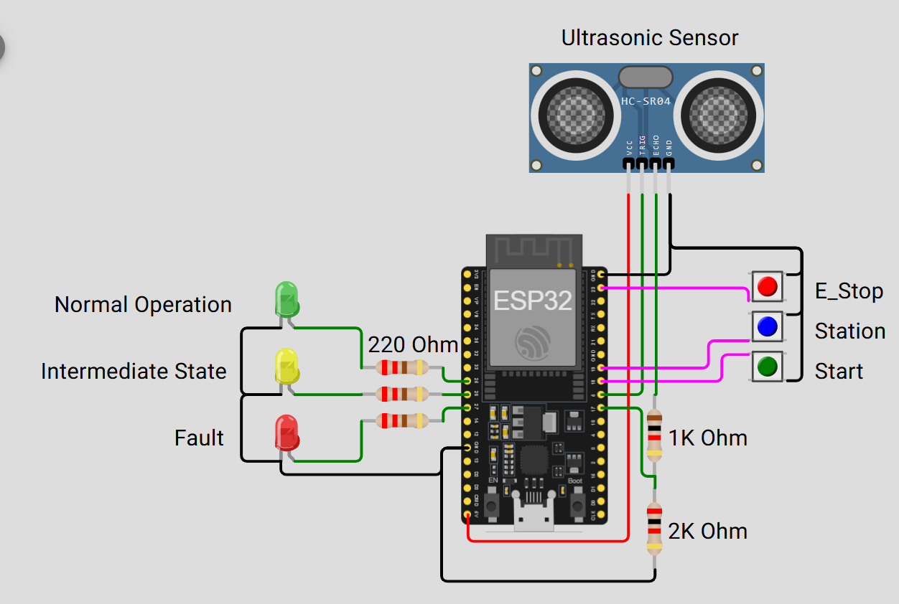
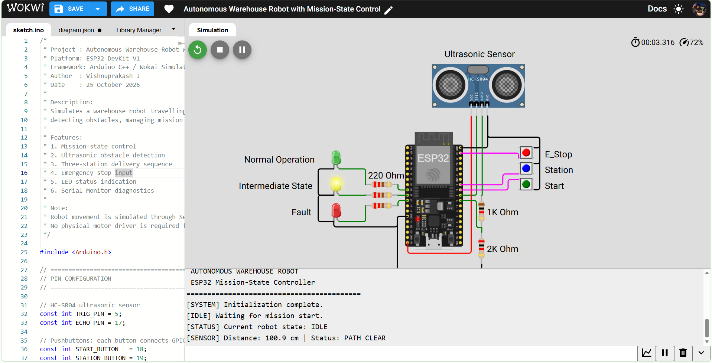
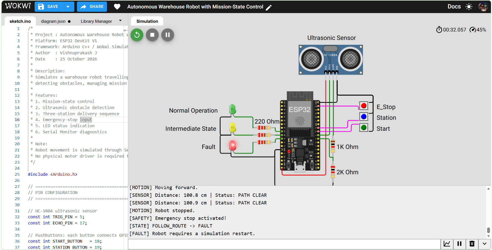

# Autonomous Warehouse Robot with Mission-State Control

An ESP32-based simulation of a warehouse robot controller built with Arduino C++ and Wokwi. The project demonstrates mission-state management, ultrasonic obstacle detection, station servicing, emergency-stop handling, and LED status indication.

> **Scope:** This is a controller simulation. Robot movement and route following are represented in software and Serial Monitor messages; physical motors and autonomous navigation are not implemented in this version.

## 1. Project Overview

Warehouse robots need to manage mission progress, monitor nearby obstacles, respond to operator commands, and handle fault conditions. This project implements a simplified controller for a robot that follows a predefined mission sequence and services three warehouse stations.

### Key Features

- ESP32 DevKit V1 controller programmed in Arduino C++
- HC-SR04 ultrasonic distance measurement
- Obstacle detection using a configurable 15 cm threshold
- Finite-state machine (FSM) for mission control
- Three simulated warehouse stations
- Start, station-confirmation, and emergency-stop buttons
- Green, yellow, and red LED status indicators
- Serial Monitor diagnostics
- Distance reporting every 30 seconds while sensor polling continues at a shorter interval

## 2. Circuit and Simulation Screenshots

### Circuit Overview

The circuit connects the ESP32 to the ultrasonic sensor, three push buttons, and three LED indicators. The diagram also labels the LED current-limiting resistors and the voltage-divider resistors for the ultrasonic sensor signal.



### Startup and Idle State

The controller initializes and waits for the start-button input. The Serial Monitor displays the initial state and sensor reading.



### Mission Start

Pressing the start button initializes the delivery mission and transitions the controller from `IDLE` through `START_MISSION` to `FOLLOW_ROUTE`.


### Station Servicing

Pressing the station button simulates arrival at the next warehouse station. The robot is logically stopped while the station service operation runs.


### Emergency-Stop Handling

Pressing the emergency-stop button triggers the fault-handling path. The firmware reports the state transition to `FAULT` and indicates that a simulation restart is required.



## 3. Component Selection

| Component | Quantity | Purpose and Reason for Selection |
|---|---:|---|
| ESP32 DevKit V1 | 1 | Main controller; offers GPIO, timing functions, and Arduino C++ support. |
| HC-SR04 ultrasonic sensor | 1 | Measures distance to a nearby object without contact; suitable for a simple obstacle-detection demonstration. |
| Push buttons | 3 | Provide mission-start, station-confirmation, and emergency-stop inputs. |
| Green LED | 1 | Indicates normal operation or mission activity according to the firmware logic. |
| Yellow LED | 1 | Indicates an intermediate condition, such as station service or obstacle handling, according to the firmware logic. |
| Red LED | 1 | Indicates a fault or emergency-stop condition. |
| 220 Ω resistors | 3 | Limit current through the LEDs. |
| 1 kΩ and 2 kΩ resistors | 1 each | Form a voltage divider for reducing the HC-SR04 ECHO signal voltage before it reaches the ESP32 input. |
| Jumper wires / virtual breadboard connections | As required | Connect components in the Wokwi circuit. |

### Why ESP32?

The ESP32 provides enough GPIO pins for the sensor, buttons, and LEDs, as well as timing and serial-debugging features. It is a convenient platform for demonstrating embedded control logic in a simulator.

### Why HC-SR04?

The HC-SR04 determines distance by measuring the time taken for an ultrasonic pulse to travel to an object and return. The firmware calculates distance approximately as:

`Distance (cm) = Echo duration (µs) × 0.0343 / 2`

The factor of two accounts for the sound wave's round trip. The project uses a configurable obstacle threshold of **15 cm**.

The circuit includes a 1 kΩ / 2 kΩ resistor divider on the ECHO signal. This reduces the sensor's nominal 5 V output to a level closer to 3.3 V for the ESP32 input. For physical hardware, verify the divider orientation, actual resistor values, and the electrical specifications of the sensor and board.

## 4. Why No Physical Motor Is Included

Physical motors were intentionally left out to keep this version focused on the embedded firmware architecture and make the mission logic easy to test in Wokwi. The current circuit demonstrates sensing, state transitions, operator inputs, LED status, and fault handling without requiring motor-driver hardware.

Movement is simulated through state changes and Serial Monitor messages.

| Robot Function | How It Is Represented |
|---|---|
| Start moving | The mission starts and movement is reported in the Serial Monitor. |
| Follow route | The `FOLLOW_ROUTE` state represents travel along a predefined route. |
| Detect obstacle | The measured distance is compared with the 15 cm threshold. |
| Stop for obstacle | The controller enters the `OBSTACLE_STOP` state. |
| Service a station | A button confirms arrival and a timed service operation is simulated. |
| Complete mission | The controller reports completion after all three stations are serviced. |
| Emergency stop | The controller enters the `FAULT` state. |

This version does **not** physically drive motors, autonomously navigate a route, or perform real warehouse operations. Station arrival is manually confirmed with a push button.

### Possible Future Motor Integration

A future hardware revision could add suitable DC geared motors, a compatible motor driver, wheel encoders, PWM speed control, and a suitable battery/power system. The exact components should be selected based on robot mass, required speed, torque, and current. Additional sensors or navigation methods would also be needed for real autonomous movement.

## 5. Pin Connections

| ESP32 Pin | Component | Function |
|---|---|---|
| GPIO 5 | HC-SR04 TRIG | Sends the ultrasonic trigger pulse. |
| GPIO 17 | HC-SR04 ECHO, through resistor divider | Receives the echo pulse at a reduced voltage. |
| GPIO 18 | Start button | Starts the mission. |
| GPIO 19 | Station button | Confirms arrival at a station. |
| GPIO 23 | Emergency-stop button | Triggers the fault state. |
| GPIO 25 | Green LED | Status indication. |
| GPIO 26 | Yellow LED | Status indication. |
| GPIO 27 | Red LED | Fault indication. |
| 5V/VIN | HC-SR04 VCC | Sensor supply, according to board and sensor requirements. |
| GND | Sensor, buttons, LED circuits | Common electrical reference. |

The buttons use `INPUT_PULLUP`: a released button reads `HIGH`, and a pressed button connected to GND reads `LOW`. The firmware includes button debouncing to reduce false multiple detections.

Each LED is connected in series with a 220 Ω current-limiting resistor.

## 6. Software Architecture and State Flow

The firmware is written in Arduino C++ and uses a finite-state machine (FSM) to represent the current operating condition.

| State | Description |
|---|---|
| `IDLE` | Waits for the start command. |
| `START_MISSION` | Initializes the mission. |
| `FOLLOW_ROUTE` | Represents travel along the predefined route. |
| `OBSTACLE_STOP` | Represents a stop after obstacle detection. |
| `STATION_SERVICE` | Simulates service at a warehouse station. |
| `MISSION_COMPLETE` | Indicates that all three stations have been serviced. |
| `FAULT` | Indicates an emergency-stop or fault condition. |

```text
                    +----------------+
                    |      IDLE      |
                    +----------------+
                            |
                       Start button
                            v
                    +----------------+
                    |  START_MISSION |
                    +----------------+
                            |
                            v
                    +----------------+
             +----->|  FOLLOW_ROUTE  |<-----+
             |      +----------------+      |
             |          |          |         |
        Path clear   Obstacle   Station      |
             |          |       button       |
             |          v          v         |
             |   +--------------+ +----------------+
             +---| OBSTACLE_STOP| | STATION_SERVICE|
                 +--------------+ +----------------+
                                        |
                                  Service complete
                                        |
                               More stations remain
                                        |
                                        +----> FOLLOW_ROUTE

                            All 3 stations serviced
                                      |
                                      v
                             +------------------+
                             | MISSION_COMPLETE |
                             +------------------+

                 Emergency-stop button
                            |
                            v
                       +----------+
                       |  FAULT   |
                       +----------+
```

The diagram shows the intended flow; actual behavior depends on the transition conditions implemented in `sketch.ino`.

**Safety limitation:** The emergency-stop button in this project demonstrates software fault handling only. It is not a substitute for an independent, appropriately designed hardware emergency-stop system on a physical robot.

## 7. Obstacle Detection and Distance Reporting

The sensor is polled frequently so obstacle handling does not have to wait for the next printed report.

| Parameter | Value | Purpose |
|---|---:|---|
| Obstacle threshold | 15 cm | A valid measurement below this threshold indicates an obstacle. |
| Sensor polling interval | 100 ms | How frequently the firmware requests a distance measurement. |
| Distance print interval | 30 seconds | How often the distance is printed to the Serial Monitor. |
| Station service duration | 2 seconds | Simulated service time per station. |
| Obstacle timeout | 15 seconds | Timeout configured for obstacle handling, if enabled in the firmware logic. |

Keeping polling and printing intervals separate is important: the firmware can continue checking for obstacles every 100 ms while printing the latest distance only every 30 seconds. This avoids delaying obstacle checks just to reduce Serial Monitor output.

## 8. How to Run the Simulation

1. Open [Wokwi](https://wokwi.com/).
2. Create or open the ESP32 DevKit V1 project.
3. Add/connect the HC-SR04, three push buttons, three LEDs, and resistors.
4. Confirm the wiring against the pin-connection table above.
5. Paste the firmware into `sketch.ino`.
6. Start the simulation.
7. Press the start button to begin the mission.
8. Press the station button to simulate arrival at each station.
9. Change the HC-SR04 target distance to test obstacle detection.
10. Press the emergency-stop button to test the fault-handling behavior.

### Suggested Test Cases

| Test | Action | Expected Behavior |
|---|---|---|
| Startup | Run the simulation without pressing buttons. | Controller remains in `IDLE`. |
| Start mission | Press the start button. | Mission initializes and the controller enters the route-following sequence. |
| Clear path | Set the simulated target beyond 15 cm. | A valid measurement should indicate a clear path. |
| Obstacle | Set the target below 15 cm. | The controller should detect the obstacle and enter `OBSTACLE_STOP` when the reading is processed. |
| Station service | Press the station button during the mission. | The next station service operation is simulated. |
| Mission completion | Confirm all three stations. | Controller reports mission completion. |
| Emergency stop | Press the emergency-stop button. | Controller enters `FAULT` and reports that the simulation must be restarted. |

Test results depend on the exact state-transition logic and the states in which button presses are accepted.

## 9. Expected Serial Monitor Output

The following examples illustrate the type of output produced by the firmware. Exact wording and ordering can vary.

**Startup**

```text
AUTONOMOUS WAREHOUSE ROBOT
ESP32 Mission-State Controller
[ SYSTEM ] Initialization complete.
[IDLE] Waiting for mission start.
[STATUS] Current robot state: IDLE
```

**Mission Start**

```text
[MISSION] Starting warehouse delivery.
[STATE] IDLE -> START_MISSION
[MISSION] Mission initialized.
[MISSION] Total stations: 3
[STATE] START_MISSION -> FOLLOW_ROUTE
[MOTION] Moving forward.
```

**Distance Report**

```text
[SENSOR] Distance: 100.9 cm | Status: PATH CLEAR
```

**Station Service**

```text
[INPUT] Station button pressed.
[MOTION] Robot stopped.
[STATION] Arrived at station 1 of 3
[STATE] FOLLOW_ROUTE -> STATION_SERVICE
[STATION] Processing station 1
```

**Emergency Stop**

```text
[MOTION] Robot stopped.
[SAFETY] Emergency stop activated!
[STATE] FOLLOW_ROUTE -> FAULT
[FAULT] Robot requires a simulation restart.
```

## 10. Skills Demonstrated

- Embedded C++ programming
- ESP32 GPIO configuration and digital input handling
- Ultrasonic sensor interfacing
- Periodic scheduling using `millis()`
- Button debouncing
- Finite-state-machine design
- Event-driven control logic
- Obstacle detection and fault handling
- Serial debugging and system-status reporting
- Embedded-system simulation and test-case design

## 11. Future Improvements

- Add motors and a motor driver for physical movement.
- Add wheel encoders for speed feedback and odometry.
- Implement PWM-based speed control.
- Add line-following sensors or a navigation/localization method.
- Add UART or CAN communication with a supervisory controller.
- Improve sensor-failure detection and event logging.
- Add unit tests for state transitions and fault scenarios.
- Add battery monitoring and low-voltage warnings.

## 12. Project Summary

The **Autonomous Warehouse Robot with Mission-State Control** project demonstrates how an ESP32 can coordinate sensor input, operator commands, mission progression, status indication, and fault handling through a finite-state machine.

Although physical movement is not implemented, the simulation provides a foundation for understanding the embedded software architecture of an autonomous mobile robot. The state-based design can be extended with motor control, navigation, and feedback systems in a future hardware version.

**Technologies:** ESP32 · Arduino C++ · Wokwi · HC-SR04 · Finite-State Machine · Embedded Systems · Sensor Interfacing · Fault Handling
